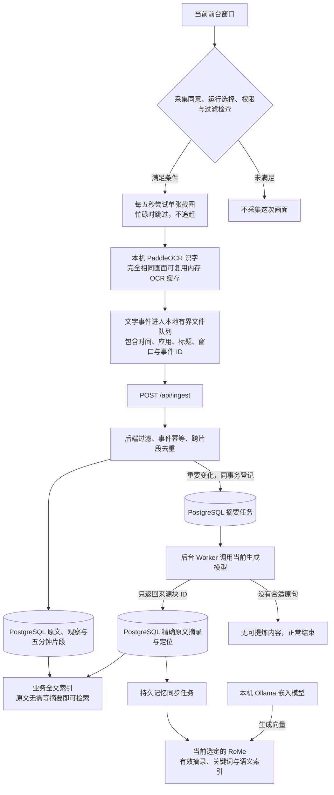
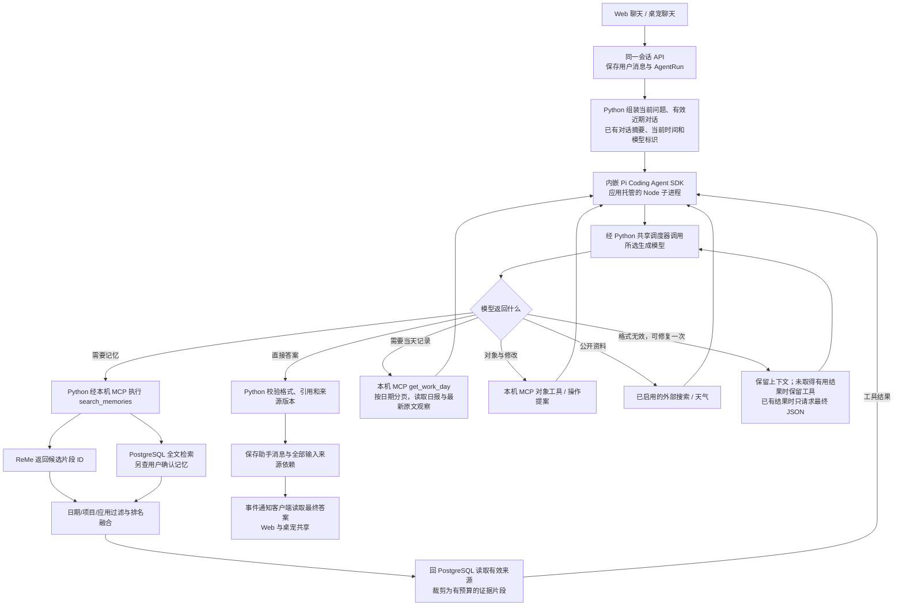
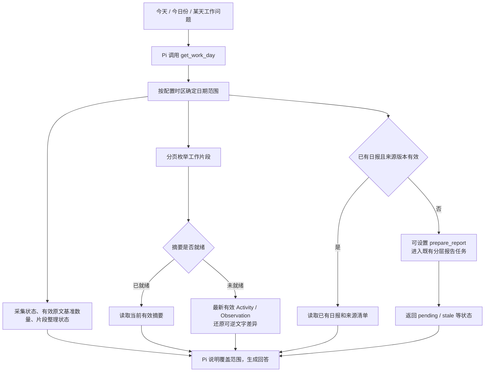
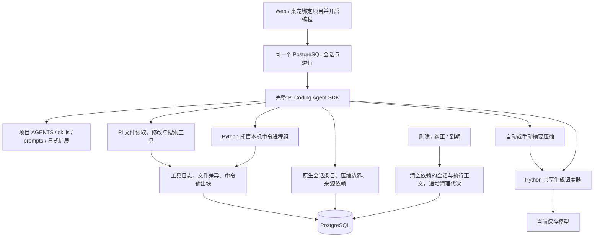

# 拾忆当前数据流：采集、记忆、问答与 Pi

依据 2026-10-12 当前源码梳理。本文描述已实现的路径；四个板块的职责与工具设置见 [模块架构](mcp-architecture.md)；运行状态和当天数据量见 [验证记录](verification.md)。

## 工作如何被记录

- 默认只记录可采集前台窗口的可见文字；不代表完整工作行为，也不连续录像、不监听普通按键。截图只在内存及本机 OCR 请求中存在。排除应用、标题和安全输入检查在采集前执行，返回结果还会核对当前窗口和采集状态。
- 定时截图有精确画面 OCR 缓存；这是当前代码的实际优化。OCR 故障不会静默改成 AX 正文采集。AX 在默认模式下主要辅助定位窗口和安全输入判断。
- OCR 文字先进入有容量限制的本地队列，上传获得后端接受或过滤确认后再删除。后端凭事件 ID 处理重传，关键变化在大模型调用前判断。
- 五分钟片段是归档单位，不是每五分钟必生成一条记录。定时模式跨片段去重，画面长期不变不会仅因跨时间段新增摘要任务。同片段近似内容可用完整基准和可逆差异表示。
- 原文入库会建立全文索引。自动提炼通常等当前五分钟窗口闭合后选择带上下文的原文块，由后端按 ID 写入原句；因此原文、摘要、ReMe 索引有先后进度，不能把“刚入库”当成“三层已经全部就绪”。
- PostgreSQL 是应用认可的来源。ReMe 当前接收的是应用已经生成的**当前有效摘录或用户确认内容**，由公开 `write/index/search` 接口管理文档与索引；没有启用 ReMe 独立 Agent，也没有把每张截图或所有 OCR 原文再交给 ReMe 自主总结。Graphiti 是另一个可选后端，普通写入只进入当前选定的一家。
- 默认原文和聊天保留 30 天；自动摘录随原文到期，用户确认的独立记忆长期保留。旧自动摘要单独隔离供本人核对，不交给模型；渐进复核只读取尚存原文。删除、纠正和到期会影响依赖它们的回答与其他派生内容。

实现入口：[Swift 采集与上传](../macos/Sources/WorkMemory/main.swift)、[入库与去重](../backend/workmemory/ingestion/service.py)、[摘要任务](../backend/workmemory/episodes/service.py)、[记忆同步](../backend/workmemory/memory/sync.py)、[ReMe 适配](../backend/workmemory/memory/reme_adapter.py)。

## 提问如何得到回答

**当前是模型先判断、按需检索的 Agent 循环，并不是每次提问都先由记忆服务提供片段。** Pi 首次看到的是当前问题和有效会话上下文；工作记忆只会在相关工具被调用后进入本轮上下文。简单问候从首轮关闭工具，其他问题提供工具让模型选择。

每次搜索实际包含：

1. 从 PostgreSQL 读取选定后端；调用 ReMe 获取语义/关键词搜索候选。ReMe 暂不可用时保留业务全文检索，并附降级提示；这不涉及切换生成模型。
2. 中文分词后查询 PostgreSQL 全文索引，涵盖有效原文、摘要和结构化事实。用户确认的记忆另在 PostgreSQL 按文字检索，当前不是全部同步到 ReMe。
3. 按日期、项目、应用过滤，再融合两路排名。候选 ID 必须回业务库核对来源版本、删除与到期状态，不能直接使用框架里可能过时的正文。
4. `search_memories` 单次最多交给模型 5 条片段；单条最多约 900 字，本轮累计工具资料默认 1,600 万字符；最多 1,024 次实际模型请求、16,384 次工具调用、4,096 次记忆搜索及 4,096 次外部查询，整轮最长 24 小时。Pi 根据模型容量生成上下文摘要、保存压缩边界和近期工具轮次后继续任务；原始会话树与全部来源依赖留在 PostgreSQL，失效时一起清空。格式修复计入实际请求上限。工具兼容性探测另使用合成文本并按配置缓存。
5. Pi 将工具结果加入上下文，再次调用模型。批量管理使用 `todo.delete_many` 由业务服务一次固定清单，不需要模型逐条读取并提案。Python 最后核验引用身份及全部消费来源，保存答案；客户端看到的是验证后的最终回复，而非未验证草稿。

Pi 当前还可调用 `list_objects`、`get_object` 和 `get_work_day`，与原 `search_memories`、`get_evidence`、`get_neighbors`、`get_project_brief`、`list_workspace`、`propose_operation` 共用本机 MCP。用户启用后可使用外部搜索及天气；`get_project_brief` 当前只取该项目的前 6 条证据概要，不等于读取完整分层报告。

最终模型协议包含 `answer`、`evidence_ids`、`memory_status`、`operation_status` 和 `operation_ids`，另以 `external_source_ids` 引用本轮外部资料。`memory_status` 由模型声明普通交流、已有历史依据或依据不足；Python 拦截非法引用，未实际查询就声明依据不足时要求补查。操作声明则按本会话的实际卡片、状态、到期与来源核验，不能凭一句“已生成”视为完成。上述问题共用一次带工具的修复机会，普通交流仍不强制检索。这些校验依赖结构化声明，不保证所有自然语言内容都正确。

格式修复每轮最多一次。模型尚未完成有用检索或提案时，修复保留可用工具，允许补齐取证；取得有用结果后收起工具，完成结构化答案。已有工具不回放，修复消耗同一模型预算。具体工具选择仍由模型判断，不能由格式校验保证所有问题都进行了正确取证。

实现入口：[共享聊天 Hook](../frontend/src/hooks/useAgentChat.ts)、[Agent 管理与来源校验](../backend/workmemory/agent/runtime.py)、[工具与提示](../backend/workmemory/agent/tools.py)、[Pi 进程](../agent/worker.mjs)、[检索与来源解析](../backend/workmemory/evidence/service.py)。

## Pi 在哪里，分别由谁负责

| 组件 | 当前职责 |
|---|---|
| Swift / PaddleOCR | 获取允许采集的前台窗口画面，识别并上传文字 |
| Python / PostgreSQL | 保存真实业务来源、任务和会话；执行工具、过滤来源、管理凭据及确认事务 |
| ReMe | 保存已同步摘要并提供检索候选；不负责最终聊天回复 |
| MCP | 本机业务工具协议、用户启用的外部只读服务、发现与调用边界；不承担权威业务状态 |
| Pi Coding Agent SDK | 接收会话上下文，组织模型调用和工具结果的循环；Web/桌宠共用这一套运行能力 |
| 所选生成模型 | 理解问题、产生工具调用、基于结果生成回答；还供后台片段整理和报告任务使用 |
| Web / 桌宠 | 两个交互入口，共享消息、运行与确认卡片 |

Pi 每次运行创建 Agent 对象；持久会话与记忆由 Python/PostgreSQL 提供，不靠一个常驻 Pi 对象记住整个工作日。Pi 的模型请求经 Python 转发，Node 不持有服务密钥。采集、片段摘要和日报生成分别有自己的应用任务流程；Pi 没有自动接管这些流程。

## “总结今日工作”现在走什么路径

按日期枚举不依赖关键词命中，因此“今日份”不必先被通用搜索的时间词规则识别。当前 `raw_count` 是仍保留的 Activity 原文基准数量，不是截图总数；近似观察可能共用一个基准。未整理片段可提供最新观察还原的原文片段，已整理片段优先使用摘要。每次仍受分页、摘录与工具预算限制，不能把读取一页称为完整工作日。

已有分层日报流程枚举全部有效已整理摘要，按批次生成并持久记录来源版本。`prepare_report` 只请求/复用该后台任务，不会让尚未处理的数据瞬间变成完整日报。工具只返回来源清单仍匹配的 ready 自动日报；人工编辑仍在回顾页独立管理。

回答需要区分：没有当日有效记录、已有原文但摘要待整理、只读取部分记录、日报待生成/已过时，以及模型或工具失败。采集状态只能说明当前状态，不能证明整天均有记录。普通闲聊继续按需直接回答。

## 编程、命令与压缩数据流

编程产物不会自动成为长期个人记忆。来源清理会删除应用内保存的相关执行内容，但不回滚项目文件。压缩是为了让同一个 Agent 继续当前任务，不替代 ReMe/Graphiti 的记忆检索。详见 [Pi 会话与上下文压缩](embedded-agent.md#pi-会话与上下文压缩)。
