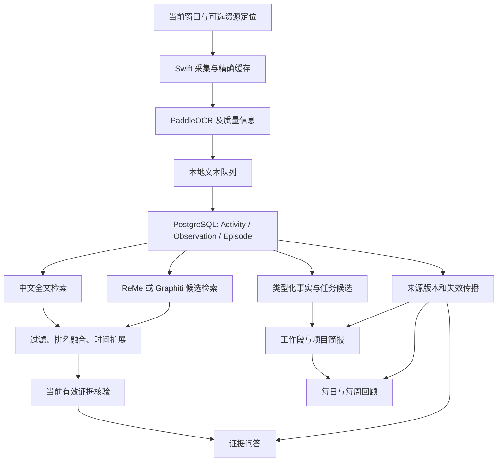

# 拾忆开发规划：从工作记录到可恢复的工作上下文

日期：2026-10-09。规划依据见 [源码分析](reference-analysis.md)，上游代码版本见 [参考仓库清单](../references/repos.lock.json)。本文保留初始规划。2026-10-09 已实施首轮内置 Agent、证据检索、项目简报、日报与 OCR 缓存；具体行为、接口与本轮边界见 [实施说明](embedded-agent.md)，实测范围见 [验证记录](verification.md)。

## 当前实施版本

本轮继续完成 Web 与原生桌宠共享 Pi、操作确认卡片、对话摘要与历史分页、记忆冲突提示/替换、项目别名/归并、可编辑工作段、分层日报/周报、待办合并与拒绝记忆、反馈、可选网页 URI、历史回填和资源策略。具体行为和限制见 [macOS 个人版实施说明](personal-companion.md)。2026-10-10 又完成工作记忆、Pi、MCP、桌宠四个板块的职责划分：共享业务工具、本机 MCP、用户启用的只读外部搜索/天气、对象选择与待办删除、按日查询，以及来源生命周期贯通。当前边界以 [模块架构](mcp-architecture.md) 为准；不接入 OpenCode，也不向外部 Agent 开放应用。下面阶段表保留为历史规划，不作为当前待办清单。

原始阶段表和目标保留作设计依据，不代表每个指标已经验收。检索基准、实际模型合成问答、安装和权限实测以 [验证记录](verification.md) 为准；人工语义标注、两次真实工作日、干净 Mac 安装不能用短时自动化替代。

## 1. 目标和范围

首轮交付围绕三个用户问题：

1. “上周那个结论在哪里？”——找到正确的历史记录，有可检查的来源。
2. “这个项目接下来做什么？”——恢复进展、决策、阻塞、明确的下一步和相关材料。
3. “我今天完成了什么？”——形成可编辑的日报，并区分完成、计划、等待和未知。

沿用现有 Swift 采集、PaddleOCR、FastAPI、PostgreSQL、原生 Ollama、ReMe / Graphiti 和 React。截图继续只在内存中处理；业务层不新增 SQLite、Redis、pgvector，也不把云模型设为兜底。五分钟 Episode 继续作为可追溯的证据单位，智能聚合在上层实现。

工作量按一名熟悉当前代码、专职开发的工程师估算，核心阶段约 **16–24 个开发日，按 4–6 周安排**；可选扩展另计。估算包括对应测试和集成，不含未知的 macOS 权限问题、真实工作数据标注等待或模型效果反复调优，不能当作确定交付日期。

## 2. 目标结构

新增聚合内容使用现有持久 Job 机制。业务写入和任务登记同事务；模型推理在事务之外；写回前校验所有来源版本。由来源驱动的产物必须可以重建。

## 3. 建议的数据模型与接口

这是设计草案，实施时以迁移审阅为准。优先新增表和可空字段，避免一次改写现有片段。

| 对象 | 最小字段 / 关系 | 用途与约束 |
|---|---|---|
| `Observation` 扩展 | 可空 `resource_uri`、`resource_type`、`quality`、`capture_policy_version` | 关联当前网页或文档，区分 OCR 空结果、低质量、普通捕获。资源 URI 先按白名单获取并去掉 query/fragment；原文保留期内清理敏感路径。没有权限时字段为空，不能从窗口标题编造链接。 |
| `SearchDocument` 或等价 PostgreSQL 索引结构 | `source_kind`、`source_id`、`episode_id`、`revision`、中文分词后的 `tsvector`、时间/项目/应用字段 | 将 jieba 分词后的文本交给 PostgreSQL `simple` 文本配置并建 GIN 索引；用 `ts_rank_cd` 等排序。这里不是假设 PostgreSQL 自带 BM25。原文索引随原文到期删除，摘要索引按片段版本更新。 |
| `WorkFact` + `FactSource` | `kind`（进展/决策/阻塞/行动）、文本、项目、事实状态、观察时间、明确出现时的生效时间 | 不把“计划上线”写成“已上线”，不把模型置信度当作事实证明。未明确给出的负责人、截止时间和项目保持空值。来源关联保存 episode/observation ID 与版本。 |
| `WorkSession` + `WorkSessionSource` | 标题、分类、项目、开始/结束、关联 Episode/Observation 与版本 | 把连续证据组织为用户看得懂的工作段。同一 Episode 可以参与多个工作段，但必须有可区分的观察依据；不能复制同一时间给两个任务并累计虚假工作时长。 |
| `ProjectAlias` / 项目规则 | 别名、经用户确认的资源规则、`project_id` | 先精确别名和明确项目提示，再建议归并。模型不能直接创建一批同义项目或跨项目自动合并。 |
| `DerivedArtifact` + `ArtifactSource` | 类型（项目简报/日报/周报）、作用范围、body、输入版本摘要、prompt/schema 版本、状态；来源及 revision | 缓存多来源结果；任何依赖过期/纠正/删除都使结果失效。生成期间来源变化时拒绝旧结果写回。 |
| `TodoSource` + Todo 状态扩展 | 多个来源；`suggested/confirmed/done/dismissed`；可选任务归一化键 | 保留现有确认要求，阻止被拒绝的同义任务反复出现。先归一化文本和项目，再用相似度给合并建议；不以相似度直接覆盖用户任务。 |
| 最小反馈记录 | 对象 ID、当前版本、反馈类型、时间 | “有用/不准确/项目不对/忽略”。首轮用于统计和显式规则，不自动训练模型。删除对象时清理相应反馈，避免保留正文副本。 |

建议的新增或扩展接口：

| 接口草案 | 行为 |
|---|---|
| `GET /api/memory/search?q=&from=&to=&project_id=&app=&cursor=` | 支持过滤、稳定分页、来源类型与匹配片段；内部记录候选排名与耗时。 |
| `GET /api/episodes/{id}/neighbors` | 返回同项目/资源的前后证据，标明时间间隔、遗漏和原文过期。 |
| `GET /api/work-sessions?...` | 工作段列表；展开时仍访问现有片段/来源接口。 |
| `POST /api/projects/{id}/brief` | 请求或复用项目简报，返回任务状态；`GET` 读取当前有效结果。原 `resume` 路径可保留兼容并导向新简报。 |
| `POST /api/reviews/generate` | 按本地时区生成日报/周报；无新增证据时复用结果，不因打开页面反复推理。 |
| `PATCH /api/todos/{id}` 扩展 | 支持拒绝、合并建议和来源展示；人工确认与完成状态仍优先。 |
| `POST /api/feedback` | 仅写入对当前版本对象的反馈，避免旧页面反馈作用到新内容。 |

### 检索与证据的具体流程

1. **解析范围**：显式 UI 条件优先；“昨天/上周”等常见时间词按配置时区确定边界。项目别名需消歧，含糊条件在界面可见。
2. **分路取候选**：业务全文索引查询带时间/应用/项目条件；记忆后端返回有序候选。不要把不同后端的分数直接相加。
3. **兼容后端过滤限制**：能过滤的后端在检索时过滤；不能过滤时做有上限的扩展取样并用 PostgreSQL 核验。必须承认扩展取样不能保证完整召回，业务全文路补充检索；不足时返回不足，不能默默扩大用户范围。
4. **融合排序**：以 reciprocal rank fusion（按名次而非原始分数融合）为初版；例如名次从 1 起的 `sum(1 / (60 + rank))`，参数通过标注集调优。先用简单、可解释的规则，不新增一个常驻重排模型。
5. **按问题补上下文**：对“后来怎么改了”补同事实的较早/较晚证据；对“上周的原话”优先命中原文。默认最多扩展相邻 1–2 段，禁止无限把整天记录塞进模型。
6. **建立证据包**：来源 ID、版本、时间、项目、来源类型、必要片段。按 token/字符预算选择完整事实句，避免只截每段前 900 字。检索响应还需区分候选数与实际匹配总量；限额扫描产生的计数只显示为下限，不冒充精确总数。
7. **生成与核验**：返回按结论组织的引用；检查引用属于候选范围和有效版本。测试另外评估事实是否真的被来源支持，不能把“UUID 合法”当作语义正确。
8. **输出说明**：区分“尚未找到”“原文已过期”“仅有纠正后的摘要”“记录正在更新”，保留现有无证据拒答行为。

### 聚合结果的失效规则

- 每个工作段、事实和简报保存其依赖的 Episode/Observation 版本；关联关系以数据库可查询的表保存，不能只藏在一段 JSON 正文中。
- 删除/纠正事务立即使受影响的派生内容不可读并清除旧正文，再投递重建任务。推理任务完成时重新核验来源；失败时保持“待重新整理”，不能展示旧内容。
- 原文自然到期后可继续保留符合现有策略的摘要和事实，但移除原文摘录、搜索片段缓存与敏感资源定位。来源页应显示“原文已过期”，不能冒充原文证据。
- 聚合尽量取直接来源的当前事实；周报可以参考日报组织结构，但也要保留到原始 Episode 的依赖，避免只删除日报而周报旧事实仍在。
- 缓存键包含数据范围、来源版本摘要、用户编辑版本与 prompt/schema 版本。用户编辑内容单独保存，不让后台刷新覆盖；涉及用户删除的来源时明确提示重新核对，不能继续静默展示旧自动生成内容。

## 4. 分阶段开发

阶段之间按依赖顺序推进。每一阶段结束都有可独立演示的结果，不等所有功能完成后才验收。

| 阶段 | 估算 | 开发内容 / 主要位置 | 完成条件 |
|---|---:|---|---|
| **M0 可复现与基准** | 1–2 日 | 修复 L01 的忽略规则并确认源码纳管；核对并记录 L02 已一致的默认配置；扩展 `tests/fixtures/` 和 `scripts/benchmark.py`；用现有 `monitor.py` 补采集增量、队列和模型等待指标。 | 干净导出含数据库模型；现有检查通过；记录两种采集模式的基线、中文问答命中率和硬件/配置；不能用旧测试报告替代。 |
| **M1 降低无效采集成本** | 2–3 日 | 抽取可共享的精确 OCR 缓存；接入 `captureSnapshot()` 与 `processNext()`；补缓存失效、识别/交付状态分离、OCR 质量统计、静态/变化画面回放。 | 相同窗口静态内容显著降低重复 OCR，金额/日期/否定/错误变化不丢失；锁屏、暂停、窗口切换、模型配置变化时正确隔离或清理缓存。默认模式是否调整由数据决定。 |
| **M2 可用的证据检索** | 4–6 日 | 新 `assistant/query.py`、`assistant/retrieval.py`、`search/`；中文全文索引迁移；保留 ReMe/Graphiti 排名；条件过滤、RRF、证据包；扩展搜索和来源 UI。 | 标注问题找到预期来源；相关旧记录不会被新弱相关记录挤出；原文能在保留期内检索；删除、纠正、后端不可用与检索中更新都有正确行为。 |
| **M3 工作段与项目恢复** | 5–7 日 | 扩展 `episodes/service.py` 的结构化抽取；新 `facts/`、`sessions/`、`projects/`；关联表与别名；简报任务；前端项目详情页。 | 一个跨天、多应用项目能输出进展、决策变化、阻塞和明确下一步，每项可追溯；不确定项目允许未归类；删除一个来源会使相关工作段和简报立即失效。 |
| **M4 回顾与任务闭环** | 4–6 日 | 新 `reviews/`；分层生成日报/周报；按日产物的持久尝试预算、项目级待办候选归并、多来源和拒绝状态；前端按模块拆分时间线、回顾、任务和来源组件，支持按需刷新与导出。 | 日报区分完成/计划/待确认，周报不复述所有时间片；同一任务重复出现能归并建议，确认/完成/拒绝状态不被模型覆盖；编辑可保留，引用有效。 |
| **M5 资源调度与可选接入** | 另计 4–7 日 | 电量/空闲/热状态策略、分批嵌入与后台等待预算、独立维护循环；可选的浏览器资源定位、只读 MCP、反馈统计。按实测价值分小项交付。 | 交互等待和后台积压有可解释上限；开启额外功能不绕过来源核验和删除；电池模式降频可见，关闭扩展后核心流程完整。 |

最早可交付的增量版本是 **M0–M2，约 7–11 个开发日**：先把采集成本和“找得到、能核对”做稳。项目简报与回顾在此基础上继续迭代。

## 5. 可以直接拆成开发任务的清单

| 任务 | 依赖 | 改动边界 | 关键验收场景 |
|---|---|---|---|
| D01 源码纳管与默认值基线 | 无 | `.gitignore` 与干净导出验证；核对模板、README、OCR 文档，保留当前已一致的默认值 | `git check-ignore` 不再排除后端源码；干净导出能导入应用；文档中默认参数与配置一致。 |
| D02 中文回放与检索基准 | D01 | `tests/fixtures/`、基准脚本与报告格式 | 包含跨天变更、否定、同义词、旧相关/新无关记录、未知答案、删除与纠正；不使用个人正文作默认 fixture。 |
| D03 定时模式共享精确缓存 | D02 | `WorkMemoryCore/`、Swift 采集入口、现有采集状态 | 静态窗口命中；相同图片跨排除边界不能复用旧来源；文字变化立即保留；OCR 失败不入成功缓存；识别缓存命中不跳过尚未成功的持久入队。 |
| D04 排名保留与结构化过滤 | D02 | 检索服务、适配器契约、API 参数；先不改数据库 | 用可控候选明确证明高相关旧记录不被时间覆盖；相对日期跨时区正确；明确项目名不直接退化为最近八条。 |
| D05 中文全文与原文检索 | D04 | 一条固定 Alembic 迁移、索引更新/清理任务、`search/` | 删除和保留期清理同步消除索引文本；增量回填可断点恢复；10k 片段数据集可重复测量。 |
| D06 证据包与来源浏览 | D04、D05 | 问答 schema、来源/邻居接口、`SourceDrawer` / 搜索组件 | 逐项引用可点击；最新状态与历史原话使用合适来源；原文过期、纠正中、无证据有清楚提示。 |
| D07 结构化事实与工作段 | D03、D06 | schema 迁移、抽取、工作段任务、来源关系 | 混合任务的五分钟桶不会强制变成单一事实；跨午夜连续段有合理边界；不把无操作时间算成持续工作；跨桶去重留下的稀疏记录只能说明观察跨度，不足以单独推算专注时长。 |
| D08 项目简报与别名 | D07 | 项目规则、简报任务、项目详情 | 同义项目可确认归并；多来源简报有版本；删除、纠正和生成同时发生时不回写旧内容。 |
| D09 日报周报与编辑 | D08 | `reviews/`、摘要缓存、回顾页 | 一天只处理变化部分；无记录不虚构成果；周报保留直接来源依赖；用户编辑不被自动刷新覆盖。 |
| D10 待办归并与拒绝记忆 | D07 | Todo 状态、来源关系、任务页 | 同任务跨片段归并建议；相似但不同截止时间不自动吞并；已拒绝建议不因换句话再次出现；删除来源后的任务按剩余证据处理。 |
| D11 按页面刷新与界面整理 | 随 D06–D10 | `frontend/src/pages/`、`components/`、`hooks/` | 隐藏页面不持续刷新所有接口；真实状态可见；窄屏、键盘操作和已有删除/纠正流程正常。 |
| D12 后台预算、资源策略和维护独立 | M4、资源基准 | 模型调度、worker/maintenance 生命周期、采集端资源信号、状态页 | 长模型调用不延后保留期清理；新后台任务不会耗尽队列；允许当前推理完成，不宣称可以强行抢占模型。 |
| D13 资源定位、反馈与只读工具（可选） | D06、D08、权限方案 | 按需分拆资源 URI 白名单采集、反馈 API、MCP/工具适配薄层，复用业务 API | 仅允许已授权范围的 `search_memories`、`get_sources`、`get_project_brief`；不暴露原始 SQL、文件系统或删除接口；资源定位去掉敏感参数，随来源过期清理；反馈绑定对象版本。 |

上述模块名是建议新增位置，当前尚不存在的目录不要误当成已实现能力。D11 随功能分步拆分，避免单独大规模重写 UI。

## 6. 验收数据与目标

下列数值是**建议的首轮验收目标，不是现有实测成绩**。先保存 M0 基线，再在同一硬件、模型、数据与配置上比较；达不到时按误差分析调整设计，而不是只降低门槛。

| 维度 | 数据与方法 | 建议目标 |
|---|---|---|
| 检索召回 | 至少 60 个中文有标注问题，覆盖时间、项目、同义表达、事实变化；分别检查摘要和原文 | 有答案问题 Recall@8 ≥ 90%；旧高相关记录专项全部通过。 |
| 排名 | 同一批问题记录首个正确来源位置、MRR 与融合前排名 | 相对基线提高且各类问题无明显退化；时间排序只用于明确的时间意图。 |
| 无答案处理 | 至少 15 个故意缺少证据的问题 | 至少 14 个明确拒答或说明不足，不能编造具体来源。 |
| 引用正确性 | 人工逐条对照生成事实与来源；区分 UUID 有效和语义支持 | 来源有效性 100%；事实被引用证据支持的比例 ≥ 95%。 |
| 关键小变化 | 至少 50 组金额、日期、状态、否定和错误码变化 | 固定测试集全部保留；近似图像不能使关键事实被过滤。 |
| 重复 OCR | 同窗口静态画面回放 10 分钟，与 M0 同配置比较 | 稳态重复 OCR 次数降低 ≥ 80%；缓存命中与真实采集心跳分开统计。 |
| 检索时延 | 10k 合成片段和对应原文；冷/热分别记录 | 先以热态检索 p95 < 2 秒为目标，区分后端等待、嵌入、SQL 和融合。 |
| 问答时延 | 相同输入与本地模型；分别统计排队与生成 | 热态端到端 p95 < 20 秒为初始目标；冷加载和后台运行请求单列，不混入虚假的即时响应承诺。 |
| 上下文整理 | 跨应用、同项目、多任务混合回放；人工标注工作段边界 | 项目恢复不混入明确无关项目；边界/分类错误单独记录，用户可以纠正。 |
| 待办效果 | 30 组跨片段同义任务及相似但不同任务 | 同义重复明显减少；不同日期/对象不能自动合并；用户状态保留率 100%。 |
| 删除与纠正 | 将操作插入检索、推理、索引、日报、周报和项目简报生成中 | 已删除/旧版本正文无法通过任何当前接口或缓存读出；旧任务结果无法复活内容。 |
| 连续运行 | 至少一轮 2 小时回放，再做两次完整工作日的自用观察 | 无队列无界增长；模型处理能力能消化输入；记录 RSS、内存压力、swap 增量、CPU 和掉帧，不把队列字节数当 RSS。 |
| 暂停/恢复 | 锁屏、权限收回、应用排除、OCR 故障、网络/API 不可用、重启 | 不越界采集；确认前不丢文本；恢复后幂等；状态页准确解释缺口。 |

M0 基准中单独记录当前文档报告与本次运行时间，保留原始测量配置。对真实屏幕评估使用用户主动开启的采集；基准脚本自身不隐式授予权限或打开采集。

## 7. 迁移、发布与回退

1. 先修源码可复现问题，确认完整代码可导出，再新增固定 Alembic 迁移；不依赖运行时 `create_all()`。
2. 新字段可空、新表独立；旧 Episode 与 API 在过渡期继续可读。为检索 V2、工作段和回顾分别设置开关。
3. 新索引先后台回填，按 `(source_id, revision)` 幂等写入并保存游标；回填任务遵守查询优先和资源预算，不持有长事务。
4. 对同一标注集离线比较新旧检索。通过后切换默认；性能退化可切回旧检索，新表先保留，不用删库回退。
5. 派生产物的删除/纠正和保留期清理在功能启用前完成。即便功能关闭，新表中已有数据仍必须被清理，避免回退后遗漏隐私生命周期。
6. 新数据只从有效业务记录构建；不直接复制 ReMe/Graphiti 内部文件，也不跨后端手改索引。
7. 前端构建、Python 检查与集成测试、Swift 队列/采集检查按改动范围执行；涉及跨来源产物时增加并发删除和纠正测试。
8. 每阶段更新 `docs/verification.md`，注明实测、确定性替身和未验证部分。安装流程最后做干净目录验证，旧安装升级验证另列。

## 8. 首轮暂缓项

- 常驻 VLM、多模型同时加载和每帧大模型理解：先证明当前 OCR 文本链路不足，再评估按需图像理解。
- 全量视频、音频录制和视觉回放：会改变数据保留与资源假设，属于单独的产品范围。
- 直接替换为 Screenpipe、Electron 或其他项目整套基础设施：当前架构已具备事务和删除约束，迁移收益需要独立证明。
- 将 Graphiti 的跨片段实体全面共享：先保留现有隔离策略，避免派生事实在删除后残留。
- 无用户确认的外部写入、自动发消息和通用执行型插件：首轮提醒仍只在拾忆内，工具扩展优先只读。
- 只改视觉样式而不改检索和聚合：界面整理跟随功能交付，先解决来源质量和实际使用路径。
