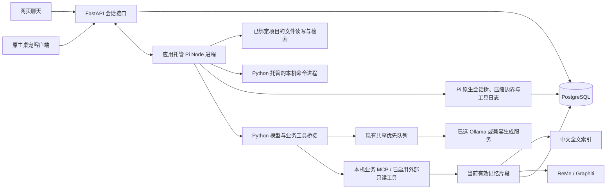

# 内置 Agent、记忆证据与工作上下文

更新日期：2026-10-11。四个板块的边界与工具配置见 [模块架构](mcp-architecture.md)。

拾忆现在由应用内的完整 Pi Coding Agent SDK 驱动聊天、编程工具循环与上下文压缩。Web 与 Swift 桌宠已连接相同的会话、消息、运行与事件接口，继续同一段对话。本轮完整实施说明见 [macOS 个人版](personal-companion.md)。

## 运行结构



- 固定依赖 `@earendil-works/pi-coding-agent@1.1.0`、`pi-agent-core@1.1.0`、`pi-ai@1.1.0`；实际依赖树在 `agent/package-lock.json`。`agent/session.mjs` 使用公开的 `createAgentSession`、`SessionManager`、`SettingsManager` 与 `ModelRuntime`。
- Python 按需启动一个 Node 子进程，通过标准输入/输出的 JSON 行协议通信。Pi 自己执行工具循环；Python 管理数据、权限边界、来源验证和持久状态。
- 不需要安装 Pi CLI。生成密钥与应用令牌不注入 Node、网页或命令环境。启用编程并绑定目录后，Pi 可自主读写文件和运行终端命令；应用内待办/记忆变更仍走确认卡片。本机代码以当前用户权限运行，工作目录不是沙箱；任意受信任代码仍可能主动读取该用户能访问的文件。
- 模型请求继续走已有共享调度器，问答优先于尚未开始的整理。已发送的模型请求允许结束；取消会阻止后续调用与答案发布。
- 每轮默认最多 1,024 次实际模型请求、16,384 次工具调用、4,096 次记忆搜索及 4,096 次外部调用，累计工具资料 1,600 万字符，最长 24 小时；统一读取 `Settings.agent`，旧本地 YAML 缺少该节会继承新默认值。这是执行上限，不是模型费用额度。首次用当前模型处理需要工具的问题前另做一次合成工具兼容性测试；严格匹配的问候、感谢与身份介绍不依赖工具测试。模型不支持工具时明确报错，不切换提供方。
- Pi 会在接近所设模型容量时生成上下文摘要，保留近期消息与工具配对后继续任务。用量优先采用提供方返回的 token 数，缺失时显示估算；不再按旧字符窗口直接省略历史。
- 只输出实际执行进度和经过核验的最终答案，不向客户端展示思维链或尚未核验的草稿。
- 到配置允许的最后一次模型请求时收起工具，使用已保存提供方的结构化输出模式请求最终答案；直接采用当前模型设置的 `max_tokens`，没有额外的 2,200 token、6,000 正文字符或 20 引用限制；引用仍须逐个有效。严格匹配 `CASUAL` 的问候、感谢和身份介绍从首轮就不提供工具，仍由同一个 Pi 执行；其他问题保留工具能力，由 Pi 根据语义和上下文按需使用，普通交流不要求搜索。该匹配只控制工具开销，不限制可回答的问题。
- 没有工具调用的空正文或非法最终 JSON，每轮最多一次结构化修复；保留原上下文、不回放工具、不传回坏输出。尚未取得有用工具结果或提案时保留工具，已有结果时收起工具完成最终输出。修复也计入配置的实际请求上限，预算不足不额外请求。截断、HTTP/认证/连接/超时、工具错误和来源变化分别处理，不自动切换服务或调高输出长度。
- `error_code` 区分空响应、格式错误、截断、工具协议、认证、连接、超时、来源失效与明确的预算耗尽。Python→Pi→运行事件只传递白名单阶段、代码、HTTP 状态、结束原因及计数；不保存提示词、推理或提供方原始错误。旧通用报错展示为原因不明，不倒推成预算耗尽。

## 本机编程与项目资源

Web 和桌宠聊天底部都有“本机编程”。添加已有项目目录，点击“新建编程会话”后，Pi 可使用官方 `read/write/edit/grep/find/ls` 工具，以及由 Python 托管的 `bash`。启用后按当前任务自主执行，不逐条弹命令批准。关闭编程只影响后续运行；更换项目开启新会话，避免混用项目历史。移除目录登记、删除聊天和来源失效均不会回滚或删除已经写入的项目文件。

工具记录展示执行状态、参数、文件差异和命令退出码。命令输出分块存 PostgreSQL，模型先看到尾部预览，可用 `read_tool_output` 分页取回完整输出；网页也能继续读取。官方文件工具有自己的读取范围和截断说明，模型可继续分页读取。当前界面展示最新运行的工具记录，历史运行可通过 API 查询。

自动加载所选项目根目录的 `AGENTS.md`、`.pi/skills`、`.agents/skills`、`.pi/prompts`。JS/MJS/TS 扩展必须在“项目代码扩展”显式保存本地绝对路径；扩展以本机权限运行，只加载可信代码。默认不加载用户全局配置、全局扩展或全局凭据，也不自动安装 Pi 包。扩展可执行任意原生代码，工具日志不构成操作系统隔离或对扩展全部行为的审计；扩展控制台正文不进入应用日志。

命令使用非交互 Bash；需要交互输入的程序应使用其非交互参数。Python 管理进程组，取消、来源失效、Pi 退出时结束所属命令；监督进程在应用父进程退出时停止命令。已经发生的文件写入不回滚，主动脱离进程组的程序不在此保证内。中断后未确认完成的写操作标为“结果待核实”，禁止整轮自动重放；下一条消息让 Pi 检查实际状态再继续。

## Pi 会话与上下文压缩

每轮从 PostgreSQL 恢复 Pi 原生会话条目和当前叶节点，结束后释放 SDK 运行实例。同一个 Node 进程可服务多个会话；Web/桌宠继续同一 `conversation_id`，不另起第二套 Agent。`PiSession` 保存完整条目树、压缩摘要和边界、上下文用量以及清理代次；不使用默认 JSONL 文件会话。`AgentWorkspace` 保存目录与显式扩展，`AgentToolCall/AgentToolOutput` 保存执行日志与输出。

令模型容量为 `C`，单次输出为 `O`：

```text
reserve = max(O + ceil(0.02 × C), min(16384, ceil(0.2 × C)))
自动压缩阈值 = C - reserve
保留近期消息目标 = min(200000, floor((C - reserve) / 2))
```

例如 `C=1,000,000`、`O=65,536` 时，预留 85,536 tokens，自动阈值约 914,464 tokens，近期目标 200,000 tokens。Pi 在任务中自动压缩，也可在空闲时点击“立即压缩”。摘要请求使用同一个 Python 生成调度器和保存的提供方，输出最多 `min(16384, O)`；它不使用最终回答 JSON Schema。摘要请求计入实际模型调用次数。压缩完成后 token 数可能暂不可用，下一次模型回答后更新；提供方没有 usage 时显示估算，不显示虚假的零用量。

旧会话首次使用时，从仍有效的 PostgreSQL 消息分批导入并压缩，不直接把所有历史塞入摘要请求。中途只发布完成后的导入检查点；导入失败可以重新执行这段只读转换，不遗漏尚未导入的尾部。已迁移会话停用旧 `ConversationDigest` 后台摘要。估算不是精确分词，超长单个输入或更换为更小容量模型仍可能超出实际服务限制，失败明确显示，原记录保留。

本机编程要求在模型设置填写实际容量。普通聊天的兼容服务若未填写，仅使用明确标注的临时容量估算（至少 YAML `context_chars` 或两倍最大输出）；不能把它当作服务能力。已填写的 1M 等容量直接应用，不偷偷降低为小窗口。

每次模型请求和工具执行前写入检查点，执行前登记工具日志，执行后确认结果。重启时对未配对的工具调用补入已知结果或“结果待核实”，不自动重放。来源依赖覆盖原始 Pi 历史、压缩摘要、工具参数与输出；来源删除、纠正或到期会清空相关原始条目和日志正文，增加清理代次，旧在途检查点不能写回恢复。项目文件不进入自动长期记忆；压缩摘要也不作为用户确认记忆。

## 自然交流与记忆依据

闲聊、情绪交流、知识解释、创作、建议以及基于用户当前输入和有效对话的回复，不需要检索到记忆。个人历史事实（如此前的项目进度、决定、偏好）按需检索并引用来源。一个问题同时涉及历史与常识时，找不到的历史部分明确说明不足，其余部分继续回答；不会把整个回复替换成固定拒答。

最终 JSON 在 `answer`、`evidence_ids` 之外必须声明 `operation_status=none/pending/executed` 和 `operation_ids`：普通回答用 none/空数组；声称已生成卡片或已执行操作时，ID 必须属于本会话且状态与数据库一致。未生成、已拒绝、过期或失效的卡片不能作为待确认操作。每次请求附上近期操作状态，避免沿用旧对话中的卡片描述。

另须包含 `memory_status`：`not_needed` 表示无需检索记忆，`supported` 表示答案引用了个人历史事实，`insufficient` 表示所问历史缺少依据。Pi 模型结合完整上下文选择，后端不再用问句正则白名单决定是否允许无引用回答。缺少或非法分类、无实际卡片的操作声明、未查询就声明历史依据不足，以及声明有记忆依据却没有引用，都进入同一轮的一次修复机会。OpenAI 兼容服务在有工具时同时提供仅供传输的 `finish_answer`，要求通过业务工具或该提交工具响应；Python 将提交参数还原为 Pi 的最终答案，不执行业务操作，也不让模型混用普通文字与最终 JSON。没有工具时使用最终 JSON Schema；本地 Ollama 保持已有格式协议。修复仍允许补查/提案，不把整段混合回答替换成固定的“记录不足”。该校验依赖模型正确声明回答类型，不宣称能够理解并证明每一句自然语言。个人引用核验是否来自实际提供的有效来源；外部引用使用 `external_source_ids`，核验为本轮实际返回且未到期的资料，全部输入的来源依赖仍登记并参与失效清理。

这项分类由模型作语义判断，不能把结构验证等同于每句话的事实支持保证；应通过真实模型的闲聊、未知事实和混合问题样本持续评估。分类只用于当轮模型协议。新增对象上下文和外部引用另由 `f03a2_mcp` 迁移提供，不存入该分类。

空正文、非法最终结构和未知个人引用共用一次修复机会，并计入真实模型请求数。修复请求明确启用最终答案 Schema，并限定为当前已提供的个人引用 ID；没有引用来源时只能声明不依赖检索或历史不足。需要补查来源时仍提供工具，不能通过删除错误引用冒充校验通过。模型提供的引用在 Pi 保存最终消息前校验，正式发布时再次核对来源。

连续三次返回相同结果的单个工具或 2–4 步循环，会提示 Pi 根据已有信息回答或澄清并收起本轮工具；有新游标、对象或结果的正常任务继续执行。待办读取不再把读取时刻当作采集时间：有原片段时使用片段时间，没有记录时间时显示“未记录时间”。这不会降低保存的上下文容量或默认执行额度。

每轮系统上下文对于模型身份只注入当时生成配置的模型标识，供“你是什么模型”如实回答；不传服务地址或密钥。该标识可能是服务端别名，不代表已验证底层权重或部署方式。切换配置后新的轮次读取新标识，旧会话自述不能覆盖当前配置。

## 记忆数据与失效

`EvidenceSnippet` 具有 `id`、`source_id`、`source_kind`、`revision`、`kind`、`content`、`captured_at`、`expires_at`、`expiry_status`、`episode_id`、`project_id`、`app`、`source_link`，搜索结果另含名次与 RRF 分数。

片段种类包括原文、摘要、结构化事实和用户确认的记忆。原文来自当前有效的 Activity/Observation，差异先还原；搜索索引只保存分词向量，不以框架返回的旧正文直接回答。

中文全文采用 jieba 分词、PostgreSQL `simple` tsvector、GIN 和 `ts_rank_cd`。语义检索保留候选顺序，再以 `1 / (60 + rank)` 融合。项目、应用、日期过滤不因结果不足而放宽。时间词支持今天、昨天、本周、上周，按项目配置时区解释。候选集有上限，返回 `candidate_count` 和 `count_is_exact=false`，不宣称是全部匹配数。

每个回答登记**所有交给模型的证据**，包含历史回答继承的来源和保留期；不只登记最后选中的引用。模型完成后再次检查来源和版本，并在同一事务发布答案。纠正、删除、原文到期、忘记确认的记忆会清空相关答案与自动生成内容；读接口也独立检查，不能依赖每分钟维护任务才能生效。

- 采集原文按既有 `retention_days` 清理，默认 30 天；摘要和事实继续保留。
- 聊天内容默认保留 30 天，历史可分页加载。Pi 压缩摘要、原生会话条目和执行输出继承所有输入来源；删除和到期会清空相关正文，不能通过恢复旧 Pi 条目绕过清理。
- 记忆候选只取用户陈述的原话，不从助手回答提取，不自动确认。
- 确认的记忆长期保留；原聊天自然到期不删除已确认内容。点击“忘记”或**显式删除来源会话/消息**，会删除依赖的确认记忆，并使其他会话中的相关回答失效。
- 删除一条消息同时删除该会话之后的消息，因为后续回答可能用过它。网页当前提供整段会话删除入口，细粒度消息删除接口供后续客户端使用。
- 对话与项目文本不写入 Agent 进度事件或错误日志。运行中断、服务重启、同会话的并发请求都有可读状态。
- 网页标题含“拾忆”，采集端与后端均排除自身页面及 `local.workmemory.*` 应用，防止把助手回答再次采集成事实。

## 项目简报、日报与待办

摘要结构新增进展、决策、阻塞、行动事实，并区分已观察、计划、已完成和不确定。事实和工作段保存来源版本。工作段使用实际观察时间，每段可独立修改分类；显示的是观察跨度，不能作为连续工作时长。

打开项目简报或日报时检查当前来源版本摘要。无变化复用缓存；变化时登记持久 Job。推理发生在事务之外，写回前核对来源；普通新增记录允许显示仍有效的旧产物，删除/纠正立即隐藏旧正文。

项目简报、日报、周报读取当前有效摘要的全量来源，按有界批次分层生成并缓存中间结果。长摘要拆段处理，来源进度仅在该来源全部分段完成后推进。模型失败或未收敛不会标记完整成功。

每个产物持久记录自动尝试次数，最多三次；手动“重新整理”开启新的尝试预算。日报编辑单独保存，并用 `expected_revision` 防止页面互相覆盖。来源删除后编辑内容会隐藏并提示重新核对，数据库中的人工编辑不会被后台覆盖。可导出当前日报文本。

对象工具现在可列出和读取 `session` 工作段及 `review` 人工回顾，使用本地日期 `day` 定位。工作段的原始 `revision` 保留来源版本，独立 `edit_revision` 表示人工修改版本；工具/UI 选中对象与回答依赖使用编辑版本。迁移 `b72d4_session_edit` 为已有工作段初始化编辑版本，不重写标题或采集正文。确认修改、在途读取与来源失效分别核验，防止旧标题在修改后被重新发布。

每日回顾优先定位网页实际使用的 `review` 对象；同日没有该对象时兼容早期 `daily` 报告。人工正文保存与自动报告生成分开，网页直接编辑和 Agent 确认都清理依赖旧正文的回答及 Pi 内容。

待办列表分别返回原始 `text`、状态、截止时间和 `display_text`，模型只提交用户要求修改的字段。合并时 `target_id` 是保留对象，`other_id` 是被并入对象，确认卡片直接显示方向。多条同名匹配应先询问目标并结束本轮，确定后再生成卡片；卡片不作为候选选择器。多事项中，确认一项可能使引用旧来源的其他提案失效；执行通知会明确列出尚未执行的卡片，继续时需读取当前状态、重新提出剩余操作，不能自动确认或将失效算成完成。

待办按项目和保守文本归一化合并，保存多个片段来源；确认、完成、忽略状态不会被重新抽取覆盖。确认卡片支持 `todo.delete` 与 `todo.delete_many`；批量操作固定清单和版本，一次 UI 确认，后来新增目标不进入该批；任何失效或事务失败不会留下部分删除。删除清理正文和依赖内容并保存无正文标记，阻止后台抽取重建。用户明确确认重新创建可解除相应标记。支持少量明确词形转换，例如“需要补充验收测试”和“补上验收测试”。金额、日期、否定及对象不同的任务不会因模糊相似度自动合并。相似但不完全相同的任务提供确认合并与持久拒绝记录；任意同义表述的语义效果仍需评估。

## 接口

普通 `/api` 请求继续要求本机 Bearer 令牌；`/api/mcp` 使用独立短期运行凭证，不接受普通 UI 令牌。浏览器读取 SSE 使用 `fetch` 和认证请求头，不把令牌放到 URL。

| 接口 | 行为 |
|---|---|
| GET / POST `/api/conversations` | 列出 / 创建会话，可选 `workspace_id/coding_enabled` |
| GET / POST / PATCH / DELETE `/api/agent/workspaces[/{id}]` | 目录登记与显式扩展，更新需修订号；不删除目录文件 |
| GET `/api/conversations/{id}/context` | 来源校验后的上下文用量与压缩状态 |
| POST `/api/conversations/{id}/compact` | UUID 幂等手动压缩，空闲时执行 |
| GET `/api/agent/runs/{id}/tool-calls?offset=` | 工具日志与文件差异，50 条一页 |
| GET `/api/agent/tool-calls/{id}/output?offset=` | 完整命令输出，按块分页 |
| PATCH / DELETE `/api/conversations/{id}` | 改标题 / 修订号保护的编程配置 / 删除及清理依赖 |
| GET / POST `/api/conversations/{id}/messages` | 历史 / 提交一轮，返回 202 与 `run_id` |
| DELETE `/api/conversations/{id}/messages/{message_id}` | 删除消息及依赖它的后续对话 |
| GET `/api/agent/runs/{id}` | 查询状态、调用计数与安全错误信息 |
| GET `/api/agent/runs/{id}/events?after=` | SSE，可凭事件游标重连；完成事件只含消息 ID |
| POST `/api/agent/runs/{id}/retry` | UUID `request_id` 幂等重试失败/中断的最后一轮；复用原问题，不重复记忆候选 |
| POST `/api/agent/runs/{id}/cancel` | 网页或桌宠停止同一轮回答 |
| POST `/api/agent/probe` | 对当前已保存模型做合成工具测试 |
| GET `/api/memory/evidence/search` | `q/project_id/app/from/to/limit/cursor/include_raw` |
| POST `/api/memory/evidence/resolve` | 传 `ids`，重新读取有效片段；返回不可用 ID |
| GET `/api/episodes/{id}/neighbors` | 前后同项目记录与观察间隔 |
| GET `/api/memory/candidates` | 候选及确认记忆，可按 `conversation_id` 过滤 |
| PATCH `/api/memory/candidates/{id}` | `action=confirm/dismiss`，必须带 `expected_revision` |
| GET `/api/work-sessions` | 工作段，可按项目和日期过滤 |
| GET `/api/projects/{id}/facts` | 当前有效的类型化事实 |
| GET / POST `/api/projects/{id}/brief` | 按需简报；POST `?refresh=true` 手动刷新 |
| GET / POST `/api/reviews?day=YYYY-MM-DD` | 按需日报；POST `&refresh=true` 手动刷新 |
| PATCH `/api/reviews/{id}` | 保存独立人工编辑，检查编辑版本 |

明确要求修改且目标/字段完整时，Pi 直接提出预览卡片，等认证界面的确认或拒绝；“先给我看看”“准备删除，先别执行”可以创建待确认卡片，不能只回复一条口头确认问题。对象同名或必要信息不明时才先澄清，明确只查询/不要提案/取消时不新增卡片。

Pi 经本机 MCP 读取工具为 `search_memories`、`get_evidence`、`get_neighbors`、`get_project_brief`、`list_workspace`、`list_objects`、`get_object`、`get_work_day`；`propose_operation` 只创建待用户确认的应用操作；`propose_merge` 按现有对象的 `source_name` 和 `target_name` 明确合并方向，同名先澄清，保留后者，最终仍走相同确认事务。旧 `/api/chat`、`/api/memory/search`、`/api/review` 保留兼容；新网页聊天使用持久 Agent 会话。

桌宠可以记录并重用网页的 `conversation_id`，提交消息后观察相同 `run_id`。同一会话只能有一个活跃运行；多个客户端可以同时观察和取消。运行与历史接口返回 `error_code`、`retryable`、`retry_blocked_reason`，保留兼容的 `error`。重试使用 UUID 作为新运行主键，在既有事件 JSON 中保存 `retry_of`，无需数据库迁移。同一重试标识只启动一次；原消息的发送幂等接口返回该消息最新运行。只有最后一条仍有效、未到期的用户问题可以重试；后续消息、其他运行或本轮曾生成的任何操作卡片都会阻止整轮重放。发生过原生写操作的运行也禁止整轮重试，以免重复执行；可发送新消息核对后继续。已有卡片继续通过确认/拒绝处理。这里没有单独的“桌宠大脑”。已选择内置 Pi；不接入 OpenCode。外部 MCP 限于用户启用的只读工具，默认搜索和天气关闭；详见模块架构。

## 安装、升级与验证

Node 最低 22.19。安装/修复会按源码指纹执行 Agent 依赖安装与检查、网页构建和采集端构建；普通启动不运行 npm、编译或下载模型。

固定迁移按 `53b0f151_obs → c82e1_agent → e91d2_companion → f03a2_mcp → a14b3_pi_sdk` 升级。历史全文索引由独立维护循环每批 50 条回填，可中断后继续；维护不被长模型整理任务阻塞。现有摘要可以直接参与简报；升级前记录可在设置中开启历史回填，分批生成结构化事实与工作段，并持久记录完成版本。

开发检查：

```bash
bash scripts/agent-npm.sh ci --ignore-scripts
bash scripts/agent-npm.sh test
uv run pytest -q
WORKMEMORY_BROWSER_TEST=1 uv run pytest -q tests/integration/test_agent_web.py
bash scripts/npm.sh run build
# 使用保存的真实模型，仅处理临时合成项目
WORKMEMORY_CODING_LIVE=1 uv run pytest -q tests/integration/test_pi_sdk.py::test_saved_provider_codes_synthetic_project
```

数据库与浏览器集成测试使用随机命名的独立 PostgreSQL 数据库，自动清理。浏览器测试通过真实 Pi 进程与应用接口，生成服务使用合成替身；不代表真实模型的工具准确率、回答质量和响应时间已经验收。本轮 Pi/Web 升级无需重新构建或签名 Swift 应用。真实 1M 满窗口、最长输出和长时任务仍需单独验收，不能从短合成测试推断。

确认更正片段、长期记忆、工作段或人工回顾后，应用回执包含最新有效记录与引用，并绑定新的来源版本。旧 Pi 内容清理后，后续提问可从回执继续；再次删改来源时回执和引用它的回答/Pi 内容一并清理。查询或总结只在回答中归纳材料，不将记录里的下一步计划自动变成待办提案。

包含明确“并到/并入”关系的普通业务请求，首步先提供名称合并和读取工具；合并卡片生成后恢复其他操作，允许继续处理同条消息中的其他事项。显式新建任务、否定合并及已启用本机编程的会话不采用此首步提示。
