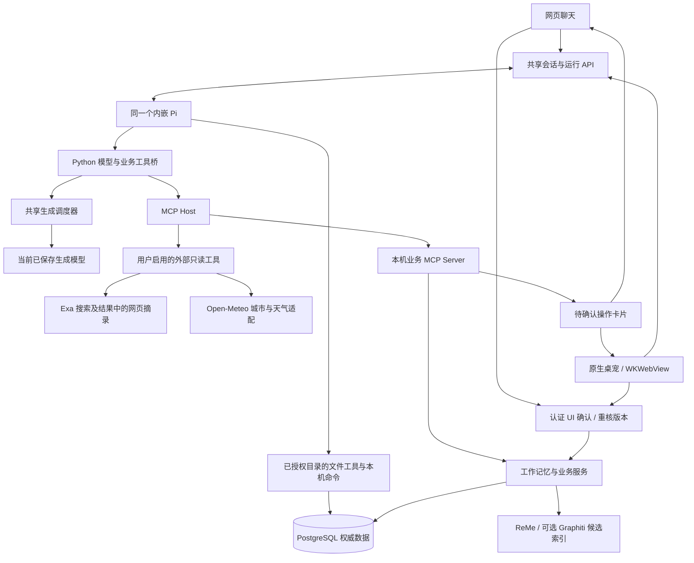
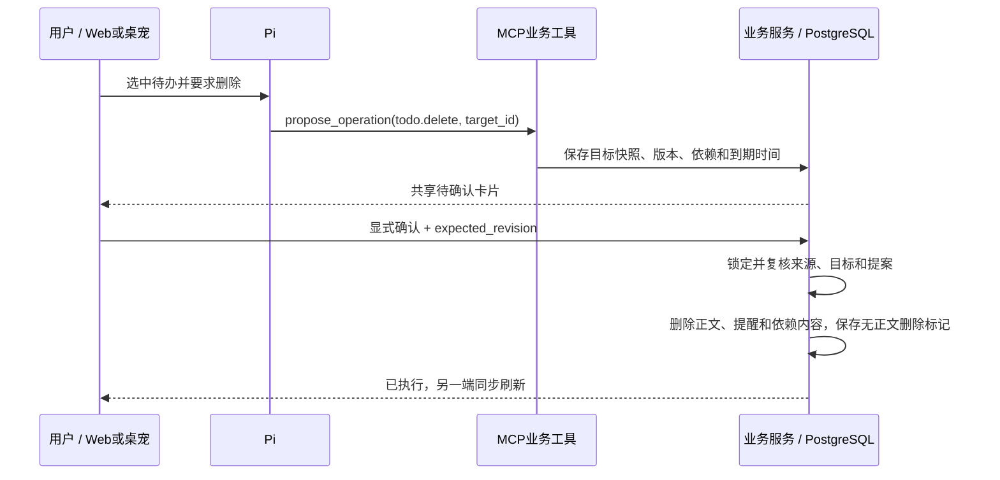

# 四个板块：工作记忆、Pi、MCP 与桌宠

更新日期：2026-10-11。本文描述已实现的架构；运行与测试证据见 [验证记录](verification.md)，采集细节见 [数据流](data-flow.md)。

## 职责与调用关系

| 板块 | 负责什么 | 实现入口 |
|---|---|---|
| 工作记忆与业务 | 采集记录、摘要、长期记忆、项目、待办、报告；来源核验、失效传播和修改事务 | `workspace/` 统一对象与操作服务；复用 `evidence/`、`episodes/`、`artifacts/`、`memory/` |
| Pi Agent | 完整 Coding Agent SDK：理解问题、检索、编程工具循环、自动压缩；原生会话由 Python/PostgreSQL 管理 | `agent/worker.mjs`、`backend/workmemory/agent/` |
| MCP | 向 Pi 提供业务工具协议；连接用户启用的外部只读工具；管理发现、权限、调用预算与外部来源 | `backend/workmemory/mcp/` |
| Web 与桌宠 | 两个交互入口，共享消息、对象选择、能力列表、取消、提醒与确认卡片 | `frontend/src/hooks/useAgentChat.ts`、共享聊天组件、Swift `DesktopPet.swift` |



业务工具定义在 `workspace/catalog.py`，执行在 `workspace/tools.py`。Pi 和 MCP 不分别维护一套业务规则；原 `companion/operations.py` 保留兼容导出。网页直接编辑与 Agent 确认使用同一业务操作服务。此前已稳定运行的采集、摘要、报告和索引模块继续承担原有职责。

本机工具使用实际 MCP SDK 的 Streamable HTTP 协议；默认通过进程内 ASGI 传输调用，没有新增监听端口。`/api/mcp` 只接受 Python 为活动运行分配的短期凭证，普通网页令牌不能作为 MCP 运行凭证。当前没有向其他 Agent 开放应用数据，也没有接入 OpenCode。编程工具归 Pi SDK 与 Python 命令执行层，不伪装成外部只读 MCP；启用编程不会使业务提案绕过 UI 确认。

## 现在怎样使用

- **删除某一条待办**：在“待办与提醒”点击“交给助手处理”，或在 Web/桌宠聊天中点击“选择对象”，按关键词搜索待办后选择。发送“删除这个”，核对卡片中的目标内容，再点击确认。明确说“把我的待办全部删除”时，服务会固定完整匹配清单并生成一张批量卡片；可以展开逐项核对，一次确认。选择对象只携带类型、ID 和版本；发送前及执行时都会核对当前对象。
- **删除全部项目**：直接说“删除我的所有项目”，或在“项目空间 → 项目管理与工作段”点击“预览删除全部项目”。`project.delete_many` 配合 `all_projects=true` 固定完整清单，一张卡片一次确认；单个项目用 `project.delete`，指定多项用 `target_ids`。卡片列出每个项目名称、别名和保留的记录/待办/记忆数量。
- **问今日工作**：直接问“你知道我今天在做什么工作吗”或“总结我今日份工作内容”。Pi 可调用 `get_work_day` 按配置时区读取当日记录量、整理状态、分页证据和有效日报；不会把语义搜索无命中当成没有采集。
- **联网与天气**：进入“偏好与状态 → 联网与工具”。预置 Exa 搜索与 Open-Meteo 天气，默认均关闭。自行启用后，两端同一个 Pi 都可按需调用。可填写常用城市；没有城市时先询问或查询城市，不读取设备位置。
- **查看能力**：聊天中的能力面板展示本轮可用业务工具、操作和服务状态。不可用的外部服务会被标明，本机业务工具仍保留。

对象选择支持待办、项目、确认记忆、已整理片段、工作段与人工回顾，支持关键词和分页；不再依赖旧 `list_workspace` 首屏每类 12 条对象。版本已变化或对象已删除时，需要重新选择，不会对另一个同名对象执行操作。

## 工具与预算

| 工具 | 返回或产生的内容 |
|---|---|
| `search_memories` | 按问题检索，融合框架候选与 PostgreSQL 全文结果；最多 5 条有效证据 |
| `get_evidence` / `get_neighbors` | 指定证据的当前内容 / 同项目相邻记录 |
| `get_project_brief` | 项目前 6 条当前有效证据概要；不等同于完整分层项目报告 |
| `list_workspace` | 每类至多 12 条项目、待办与记忆，提示分页入口 |
| `list_objects` / `get_object` | 六类对象的搜索、分页、读取及版本核验；工作段/片段/回顾可按本地 `day` 定位，返回原始正文和独立展示字段 |
| `get_work_day` | 指定本地日期的状态、分页证据与有效日报；`prepare_report` 可请求已有后台日报流程 |
| `propose_merge` | 按来源/保留对象的完整名称生成待办或项目合并卡片；精确匹配，同名需澄清，保留目标标题 |
| `propose_operation` | 仅创建待用户确认的应用操作卡片，支持 `todo.delete_many` / `project.delete_many` 一次固定批量清单 |
| `mcp_<服务>__<工具>` | 用户选中的、满足只读约束的外部 MCP 工具 |
| `weather__search_cities` / `weather__get_weather` | 通过本机 MCP 暴露的城市/天气 HTTP 适配器 |

执行上限统一来自 `Settings.agent`，Python、Pi 和能力接口使用同一份配置。默认每轮 **1,024 次实际模型请求、16,384 次工具调用、4,096 次记忆检索、4,096 次外部调用**，累计工具资料 **16,000,000 字符**，整轮最长 **24 小时**。这些是防止无限循环的执行保护，不是费用额度，也不要求必须用满才回答；完成任务即结束，用户仍可随时取消。外部调用内部对连接失败/超时最多尝试两次，所以外部调用次数不是 HTTP 请求次数。

默认值与可调整字段见 `config/app.example.yaml` 的 `agent` 节。已有 `config/app.local.yaml` 缺少该节时自动继承新默认值，不需要改写采集配置；已有显式数值优先，修改后重启后端生效。`/api/agent/capabilities` 返回实际生效值。此配置只作用于聊天执行，不改变模型密钥、生成提供方、嵌入模型或原生采集端。

完整 Pi Coding Agent 使用模型容量与 token 用量自动总结上下文，保存压缩边界并保留近期工具配对；也可手动压缩。它不再用旧字符窗口直接省略历史。业务工具仍有单次摘录和分页，累计资料额度独立计算；来源依赖覆盖全部输入及原始 Pi 条目。具体公式与未知容量处理见 [Pi 会话与压缩](embedded-agent.md#pi-会话与上下文压缩)。

相同参数和结果形成三轮稳定重复时，提示模型回答或澄清并收起本轮工具；正常分页及有新信息的查询继续，执行额度不变。最终允许的模型请求收起工具完成回答。空正文、非法最终 JSON 或未知个人引用共用一次修复机会；明确请求最终结构，需要补查引用时保留工具。修复计入实际请求数：尚未取得有用结果时保留工具，已有结果或提案时收起工具；不回放已完成工具。首次工具兼容性探测使用合成输入并按配置缓存。工具分页和摘录不代表全日覆盖，模型须说明已读范围。


闲聊、知识解释、创作和基于当前输入的交流可以直接回答。模型声明 `memory_status=not_needed/supported/insufficient`；个人历史事实仍要求有效来源。工作问题应先调用对应工具，这由提示与工具定义引导；不是对所有自然语言输入都能保证正确路由的确定性规则。

## 修改与删除的事务



回答用 `operation_status` 与 `operation_ids` 声明卡片状态，Python 核验实际会话、状态、到期及来源；未查询就声称依据不足也要求补查。操作状态声明和引用错误共用一次修复，不回放既有写入。查询/总结中的计划不能自动视作创建待办的授权。

Pi 没有确认/执行工具。所有应用修改仍需认证 UI 明确确认；同一提案重复确认幂等，来源变化或到期使卡片正文失效。

单条使用 `todo.delete`，批量使用 `todo.delete_many`。批量请求三选一：`all_todos=true`，`project_id/done` 筛选，或 `target_ids` 明确列表；不能把含糊空请求当全部。服务端一次读取最多 1,000 条未忽略且来源有效的目标，将 ID、正文与版本固定到一张卡片，不要求模型事先逐页浏览。全选默认包含已完成项。确认时核验固定清单，任何一项失效则整批失效；之后新增的待办不加入该批，事务异常全部回滚，并发/重复确认只执行一次。单张 1,000 条是业务清单上限，与模型调用额度不同，超过时需缩小范围。

项目批量删除同样以最多1,000个固定目标为上限；空请求不表示全选，没有可删除项目时不生成空卡片。确认锁定项目及关联记录的版本，任一目标、成员、别名或报告草稿发生变化则整批失效。重复/并发确认幂等，中途失败全部回滚，清单外后来新增项目保留。

删除项目移除的是项目分类及别名：原始工作记录、待办日程/提醒和独立确认记忆保留并解除项目归属，人工报告稿保留待核对；旧报告、回答、提案与 Pi 内容按来源依赖失效。数据库保留项目删除状态及原名用于抑制旧采集重建；网页、对象工具、项目引用及旧页面写入均拒绝使用该项目。此操作不会删除本机编程目录或文件；需要遗忘工作原文时仍走原文自身的删除流程。

删除待办会清除待办正文、关联提醒、依赖该待办的回答与提案正文。保存的 `TodoTombstone` 只有待办 ID、项目 ID、归一化文本哈希、来源 ID 和时间，用于阻止旧摘要后台抽取把它重新创建；项目合并迁移这些标记。并发抽取与删除使用一致锁顺序。用户明确确认重新创建同一任务可以移除相应标记。

**删除待办不等于删除它的原始工作记录。** 原始记录有独立生命周期；要忘掉来源内容，应另行删除/纠正工作片段。已有数据库备份也不会被在线删除改写。

## MCP 配置与信任边界

设置保存在不提交的 `config/mcp.local.json`，原子写入，权限 `0600`，修订号防止旧页面覆盖新值。API 仅返回是否存在凭据及环境变量键名，不返回值；更换地址、程序或参数时不会自动继承旧凭据。卸载保留，彻底清除时删除。当前单后端进程通过进程内锁串行保存，不提供多个写进程的配置协调。

支持 Streamable HTTP 和本机已安装程序的 stdio；不支持 OAuth 或自动安装包。stdio 必须配置程序绝对路径，不使用 Shell 展开，拒绝直接使用 `npx/npm/uvx/pip/brew/bash/zsh/sh` 等启动命令。HTTP 不跟随重定向、不读取系统代理环境；发现和调用有超时、结果长度与参数 Schema 检查。发现结果缓存五分钟；服务名隔离工具名。

外部工具必须经过用户勾选，并声明 `readOnlyHint=true`、`destructiveHint=false`；已知 Exa 搜索接口按明确例外处理。明显写入/执行工具名会被拒绝。**这些检查依赖对所配置服务的信任，不是对恶意服务的沙箱。** 未对远端 Schema 做版本签名固定；同名工具升级仍需人工核对。stdio 程序以当前用户身份运行，MCP SDK 还继承 `HOME/LOGNAME/PATH/SHELL/TERM/USER` 等基础环境，以及应用明确传入的 `LANG/TMPDIR` 和用户配置项；不会复制整个父进程环境，但也不构成文件系统或网络隔离。

公开搜索词和城市查询会发给相应提供方。提示要求禁止发送私人记忆正文；发送前还拦截内部来源 ID、过长参数以及与本轮私人片段连续相同的至少 20 个字符。该检查不能识别所有语义改写或短敏感信息，不应当作完备的数据防泄漏系统。用户应仅启用信任的服务。外部资料是待引用的数据，不赋予其改变权限或执行指令的权力。

预置搜索读取 Exa 返回的结果和网页摘录；没有实现任意 URL 浏览器、独立网页抓取或电脑控制工具。天气是本机适配器调用公开天气/地理编码接口，再通过 MCP 提供给 Pi。预置地址无须填写密钥即可尝试使用；服务可用性、限流和使用条款由提供方决定。

## 来源与保留

- PostgreSQL 继续作为权威业务来源；框架只提供检索候选。所有交给模型的私人来源、对象选择、历史消息和摘要都有版本依赖，不只记录最终显示的引用。
- 外部摘录保存在 `ExternalSource`，包含本轮运行/会话、提供方、标题、URL、正文、取得时间与到期时间。最终回答使用单独的 `external_source_ids`，不能冒充私人记忆证据；只接受本轮实际返回、仍有效的来源。
- 外部摘录继承本轮私人依赖与当前问题，相关回答和对话摘要继续继承这些依赖。私人来源被删改时，受影响的外部正文、标题/URL和回答也清理；外部资料默认 30 天到期，历史读取也检查有效性。
- 个人引用必须来自实际提供的证据。模型偶尔只返回 UUID 时，仅在已提供证据中唯一匹配才补齐类型前缀；未知或歧义 ID 仍拒绝。
- 客户端通知只含 ID、状态与顺序，不携带采集/对话正文。两端通过已认证读接口获取当前数据。

新增迁移为 `e91d2_companion → f03a2_mcp`：增加消息对象上下文、外部引用、待办删除标记与外部来源，不改写已有采集数据。降级会丢失新增的外部来源和删除标记，可能失去防重建语义；回退应使用与旧代码匹配的升级前备份，而不是直接降级正在使用的新业务库。

## 验证与后续边界

确定性测试使用独立真实 PostgreSQL、实际 Pi 子进程、实际 MCP HTTP/stdio 协议；浏览器和原生 WKWebView 使用合成模型。显式真实模型检查：

```bash
WORKMEMORY_MCP_LIVE=1 uv run pytest -q tests/integration/test_mcp_live.py
```

该检查在独立数据库生成合成业务内容，使用当前保存模型和实际搜索/天气服务，不改真实会话或模型配置。具体结果以验证记录为准。持续工作日的总结质量、任意第三方 MCP 兼容性、恶意服务隔离和新机器安装仍不能由这几项样本保证。

迁移 `a14b3_pi_sdk` 在此基础上增加目录登记、Pi 原生会话与执行记录。Pi 文件工具和项目扩展均属于受信任的本机执行能力，外部 MCP 的只读策略继续单独适用。

迁移 `b72d4_session_edit` 增加工作段人工编辑版本，来源片段版本另行保留。`session:ID`、`review:ID` 回答依赖同时继承底层片段/报告来源；确认修改和网页回顾编辑即时清理旧内容，在途读取依靠版本核验拒绝旧值。
