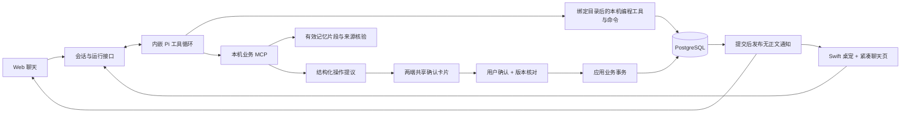

# macOS 个人版：共享 Pi、桌宠与工作记忆

更新日期：2026-10-12。本文描述本轮完成的功能；自动化、本机升级和真实使用验收见 [验证记录](verification.md)。原始规划保留在 [development-plan.md](development-plan.md)，本轮决策以本文为准。

## 产品行为

Web 的“问问记忆”和菜单栏“和桌宠聊天”使用同一个内置 Pi Agent。同一会话共享消息、运行、取消、记忆与操作卡片。桌宠是 Swift/AppKit 原生窗口，单击后用 WKWebView 打开紧凑聊天页，再次单击关闭，没有另外安装桌宠 Agent，也不需要 Pi CLI。不接入 OpenCode。Pi 通过本机 MCP 使用业务能力，外部 MCP 限于用户启用的只读工具；详见 [四个板块架构](mcp-architecture.md)。

聊天可以直接闲聊、解释知识、创作和给建议，不要求先检索到记忆。问到此前的个人工作、决定或偏好时才需要相关历史依据；没有记忆时只说明缺失的部分，仍可完成同一问题里的其他请求。“你是什么模型”依据本轮实际生成配置中的模型标识回答。

网页在“偏好与状态”配置桌宠显示、大小、PNG 形象、单图轻微动效、全屏隐藏、安静提醒、后台节省模式、网页来源定位和历史回填。新客户端可继续最近会话；已经打开的另一个会话不会被强制切走，页面提供“继续最近会话”。待办/来源/记忆修改会通知所有客户端重新读取。

桌宠支持拖动、靠近屏幕边缘时吸附、多屏位置修正与保存、右键隐藏/恢复默认皮肤/导入皮肤。锁屏、睡眠和全屏隐藏时停动画；关闭聊天面板释放 WebView、脚本桥与监听器，不取消后台 Agent；重新打开继续同一会话并读取进度。未发送草稿与尚待核对的提交标识仅保留在原生进程内，退出应用后清除；切换会话分别恢复草稿，删除或到期会话清除对应状态。菜单栏和提醒气泡的“打开对话”始终打开/聚焦窗口，只有普通单击桌宠负责切换。它与采集同属 WorkMemory 应用，**显示或点击桌宠不会开启采集**，退出应用会同时退出桌宠与采集。采集沿用已保存的同意与暂停状态。

## 桌宠聊天窗口（2026-10-10）

采用系统字体、简洁顶栏和左右消息气泡。聊天记录独立滚动，底部输入框始终可见；输入框自动增高，最多显示四行。Enter 发送，Shift+Enter 换行，中文输入法选词时不会触发发送。生成中可在输入区停止；失败后符合条件的最后一轮显示“重新回答”，继续使用原问题，不重复插入用户消息。

右上角“…”打开对话与记忆面板，可切换/删除会话、继续另一端最近的对话、管理记忆和查看提醒。来源在可关闭的面板中展示，支持 Escape 和关闭后恢复焦点；操作卡片保留在消息区。阅读历史时收到新回复不会强制滚到底部，点击“有新消息”可跳转；加载更早消息保持阅读位置。

两端聊天均有对象选择与能力面板；待办页“交给助手处理”可将指定待办带入聊天。选择对象带版本，失效时需重新选择；删除卡片默认展开目标快照。要求清空所有待办时生成单张批量卡片，含数量与可滚动的完整目标清单；按钮标明“确认删除 N 条待办”。确认只处理快照目标，后来新增的待办保留。外部引用展示链接及取得时间。

网页与桌宠复用 `useAgentChat` 及消息、输入、错误/重试、记忆组件，桌宠采用独立页面布局。原生 AppKit/WKWebView、窗口默认尺寸和最小尺寸、可信 origin 令牌注入均沿用已有实现。

## Agent 与应用操作



Pi 可读取记忆和工作对象，并提议创建/修改/合并/删除待办、创建/编辑/忘记长期记忆、添加项目别名、合并项目、调整片段归属、纠正/删除片段、修改工作段分类/标题、保存回顾编辑。模型只创建卡片，不能确认自己的提案。提案保存修改前内容与目标版本；24 小时过期。确认时重新核验来源和目标，同一提案的并发/重试只执行一次，执行结果写入共享会话。

两端共享完整 Pi Coding Agent SDK。聊天底部“本机编程”可绑定项目、开启自主文件读写和命令执行；无需逐条批准，文件差异和命令输出进入共享执行记录。目录不是沙箱，代码以当前本机用户权限运行。待办与记忆等应用操作仍使用确认卡片；没有新增 GUI 控制工具。模型密钥只由 Python 注入生成请求，不传给 Node、网页或命令环境；本机代码本身仍具备用户文件访问权限。项目资源、扩展和中断恢复见 [完整 Pi 接入](embedded-agent.md#本机编程与项目资源)。

## 数据与来源

- 业务库只有 PostgreSQL，新增迁移 `e91d2_companion`，前序为 `c82e1_agent`。新增共享通知、提案、会话摘要、项目别名、反馈、待办合并拒绝记录；待办允许没有采集片段来源，由用户在卡片确认后创建。
- 新增迁移 `f03a2_mcp` 保存对象上下文、外部来源/引用及无正文待办删除标记；删除待办不会删除原工作记录，后台抽取不会重新创建已删除任务。
- 迁移 `a14b3_pi_sdk` 增加项目目录、会话编程开关、Pi 原生检查点、工具日志和输出块，不改写采集内容或现有模型设置。
- 迁移 `b72d4_session_edit` 分离工作段的人工编辑版本和片段来源版本。工作段与人工回顾可按日期查询，修改后清理引用旧版本的回答、卡片及 Pi 内容。
- 消息携带可选 UUID `request_id`。同会话重试同一内容返回原消息/运行；相同标识配不同内容或对象上下文返回 409。
- 会话消息保留 30 天，历史接口每页 100 条，用 `next_cursor` 加载。完整 Pi 会话树与压缩边界存 PostgreSQL，按实际模型容量自动压缩，也可手动压缩；旧会话首次继续时从有效历史分批导入。已迁移会话停用旧的后台聊天摘要。原生条目、压缩摘要、执行日志与命令输出都继承来源依赖，来源失效会清空正文。
- 只有用户原话成为待确认记忆候选。相关/冲突提示使用保守文字相似度，**提示相关不等于判定矛盾**。用户可同时保留，或点击“用新记忆替换这一条”；替换在同一事务清除旧记忆和依赖旧记忆的答案。Agent 编辑确认记忆同样需要操作卡片。
- 待办推荐合并只比较有界候选、同项目、相同时间、时区与重复日程，明显数字不同不推荐；点击“不是同一个任务”持久记录这一对的拒绝。合并保留目标的确认/完成状态和所有来源。任意同义句的语义识别仍需实际数据评估。
- 项目别名用于检索范围和后续摘要归属。合并项目迁移片段、别名、待办并更新版本；旧项目不再作为可操作项目。工作段返回可独立编辑的观察片段，避免把一个合并展示行的分类只写到第一段；跨度不代表持续工作时长。
- 删除/纠正/到期会清理相关来源、回答、摘要、报告、待确认提案和反馈。只有实际状态变化才发布失效通知，避免“读历史—失效通知—再读历史”的循环。

## 历史回填、报告与资源

“历史原文复核”每次安排至多 10 个旧片段，通过持久 Job 分批检查仍保留的原文。模型只返回来源块 ID，后端提取原句，结果可以为空。每个片段保存已复核版本，任务日志清理后也不会从头重做；原文缺失也终止复核，不拿旧摘要重新推断。本次升级按用户选择开启渐进复核，可在偏好页暂停；新安装默认关闭。暂停不打断已经发出的模型请求，到期清理继续独立运行。

旧自动摘要及依赖它的展示内容保存到独立的隔离历史，只能从认证网页查看，不注册模型工具、不进入 Pi、记忆检索或自动陪伴。没有原文的旧摘要也保留给本人核对，显式删除或纠正会清除对应历史副本。旧聊天及气泡副本仍遵循各自保留期。用户确认记忆、人工工作段字段和人工回顾稿保留；旧的工作段编辑版本不能证明改过标题，标题须明确确认后才作为模型可读的对象内容。

项目简报、日报和周报使用当前有效来源的全量清单。自动部分显示精确的“屏幕摘录”，不交给模型概括成个人进展；只有用户确认的内容按日期/项目/固定分区分批整理，再逐层合并。每批正文有界，长摘要拆段处理，界面显示已处理来源数量；部分结果不冒充完整报告。中间结果保存直接来源依赖并可复用，新增/修改只使对应分区及其上层结果需要重新生成。失败受父产物三次自动尝试预算限制，最多八层合并；手动重新整理开启新预算。模型可能遗漏或概括错误，完整读取来源不等于事实完整复述。

回顾支持本地时区日报和周一到周日周报。人工编辑独立保存，来源失效时隐藏，用户可显式查看保留稿并重新核对；后台不会覆盖人工稿。网页可导出文本。来源页支持“有用 / 不准确 / 项目不对 / 忽略”反馈，反馈绑定对象版本。

标准模式沿用五秒采样；手动节省模式或系统低电量模式至少十秒，并暂停历史回填和对话摘要等低优先级任务。热状态严重/临界时停止领取新的后台模型任务；临界时采集挂起。交互问答使用共享模型优先队列；已经发出的请求允许结束。后台维护独立，不被长模型请求阻塞。桌宠原生动画 12 fps，状态心跳每两秒一次，不周期下载对话正文。

可选网页来源定位默认关闭。目前覆盖定时截图模式的 Safari/Chrome AX URL；读取范围有界，在采集前后重新核对上下文与 URI，去掉账号密码、查询参数、fragment。用户切换页面或无法确认时不附链接；原文过期/纠正/删除时清理 URI。操作触发模式暂不附资源 URI，未接入本地文档路径定位。

## PNG 形象与皮肤协议

普通形象只需一张 PNG。网页“偏好与状态 → 桌宠与工作整理 → 桌宠形象”可上传、预览并点击“应用此形象”；右键桌宠 → “导入 PNG 形象…”也可以完成同样操作。两端共用本地皮肤库和当前选择，导入后保留，重新启动继续使用。已有形象列表中可切换回“默认猫咪”。原生端正常连接时下一轮约两秒的状态轮询应用选择。

单图只接受静态 PNG，文件不超过 32 MiB、宽高各不超过 4096 像素。自动裁去外围完全透明的空白，保留比例和背景；全透明或损坏图片会被拒绝。不会自动抠图或生成动作。导入资源最长边优化到 1024 像素，适配桌宠现有 48–240 点显示范围。单图默认为轻微上下浮动，思考、待确认、完成和错误显示小状态标记；关闭“单图形象轻微动效”后仅按需重绘。锁屏、休眠、隐藏时停动画。

图片只写入本地皮肤目录，不进入 OCR、记忆、模型或聊天附件。重复上传同一形象和配置复用资源；同标识资源损坏时可以重新导入修复。上传与选择分别提交，服务离线或偏好版本冲突时不会冒充应用成功。皮肤文件缺失时原生端显示默认猫咪并给出提示。更换图片不重新编译或签名应用。

高级动画仍支持右键桌宠 → “导入动画皮肤文件夹…”。文件夹包含 `pet.json` 和一个 PNG 图集，例如：

```json
{
  "version": 1,
  "name": "我的猫咪",
  "image": "cat.png",
  "columns": 4,
  "rows": 1,
  "animations": {
    "idle": {"frames": [0, 1], "fps": 6},
    "thinking": {"frames": [2, 3], "fps": 8}
  }
}
```

状态可使用 `idle/walk/thinking/searching/waiting/completed/error/offline`，缺失时退回 idle。新增可选 `presentation` 字段，`static` 表示单图（1×1），`atlas` 表示图集；旧配置省略该字段时保持图集行为。普通 PNG 由系统自动生成配置，用户无需填写 JSON。协议不执行脚本，不接受 URL 或跨目录路径；检查符号链接、图集大小、网格与帧索引。导入图集放在 `data/collector/desktop-pets/`，位置在 `data/collector/pet-position.json`。内置猫咪是原生矢量绘制，不使用第三方宠物素材。PNG 素材由使用者自行提供；参考项目的素材与代码许可可能不同。

## 新增接口

已有接口见 [embedded-agent.md](embedded-agent.md)。新增业务接口均要求应用令牌：

| 接口 | 用途 |
|---|---|
| GET / PATCH `/api/client/state` | 共享偏好（含 `pet_skin`、默认开启的 `pet_motion_enabled`）；写入要求 `expected_revision` |
| GET / POST `/api/pet/skins` | 列出 / 导入本地皮肤；上传为 multipart `image`，可选 `name`、动画 `manifest` |
| GET `/api/pet/skins/{id}/preview` | 带认证的 PNG 预览；浏览器用 Blob 展示，不把令牌放 URL |
| GET `/api/conversations/{id}/requests/{request_id}` | 只返回消息是否提交成功，用于重开窗口时核对，不重放消息 |
| GET `/api/client/events?after=` | 有序通知；断线游标恢复，过期游标触发 reset |
| GET `/api/operations?conversation_id=` | 共享提案与执行状态 |
| POST `/api/conversations/{id}/operations` | 创建结构化提案 |
| POST `/api/operations/{id}/decision` | `confirm/reject` 与 `expected_revision` |
| GET `/api/projects/{id}/aliases` | 已确认项目别名 |
| GET `/api/todos/merge-suggestions` | 至多 200 条活跃待办中推荐至多 20 对 |
| POST `/api/todos/merge-suggestions/reject` | 按两条待办 ID/版本拒绝合并 |
| POST `/api/feedback` | 对当前版本对象反馈 |
| GET `/api/memory/backfill` | 原文复核任务进度与开关状态 |
| GET `/api/history/legacy` | 仅认证 UI 可读的隔离历史，支持分页和片段筛选，不提供模型工具 |
| GET / POST `/api/reviews?period=weekly&day=...` | 本地时区周报 |
| GET `/api/reviews/{id}/saved-edit` | 显式查看需重新核对的人工稿 |

## 安装、回退与验收

安装/修复继续通过现有管理入口，普通启动不构建或签名。升级前做 PostgreSQL 备份并在临时库恢复检查；升级运行 `uv run alembic upgrade head`，当前增量版本为 `c83e5_scheduled_todos`；前序 `b72d4_session_edit` 在 `a14b3_pi_sdk` 后增加工作段人工编辑版本。`e91d2_companion` 是增量迁移；存在用户独立待办时拒绝降级到无法表示此数据的旧结构，应保留新结构或从升级前备份恢复。生产数据库不用于测试 TRUNCATE。

数据库备份包含会话、长期记忆、提案、偏好和报告。迁移到另一台 Mac 时还需安全保存配置/凭据、桌宠皮肤和采集同意/队列目录；不要把运行中的 PostgreSQL 数据目录当作备份。恢复详情见管理文档。系统授权仍需在 macOS 中完成，不自动重置 TCC。

可复现的合成基准：

```bash
uv run python scripts/benchmark_companion.py
# 使用已保存模型，只发送合成资料；默认 60 个有答案问题 + 15 个未知问题
uv run python scripts/benchmark_companion.py --live
# 单题复测仍加载同一万级合成数据；可多次传 --case
uv run python scripts/benchmark_companion.py --live --case unknown-5
```

脚本在独立 PostgreSQL 临时库生成 10k 片段和 10k 原文，检查 60 个预期来源与 50 个关键变化，报告在 `.cache/companion-benchmark.json`。语义后端在该基准中返回空集合，衡量业务全文路径；不能冒充真实 ReMe/Graphiti 的语义召回结果。实际模型报告保存合成问题与答案用于评估；逐轮诊断只记录完成原因、工具名及正文长度等元数据，不记录模型请求正文或凭据；出现未完成运行会使该基准失败。预期集由程序生成，人工语义标注、两次实际工作日与干净 Mac 安装验收须另行记录。


## 定时事项与小猫提醒

待办现在是用户主动设置的定时事项。采集、摘要和历史回填不自动创建；工作记录中的“明天计划做…”仅保留为工作内容。网页直接填写时间后保存，聊天由 Pi 询问缺失字段，再生成带具体日期、时间、时区与重复规则的确认卡片。模型必须逐字引用用户提供的时间，不能使用工具文本或自行补出默认时间。旧待办清理不是自动迁移的一部分；本次经用户授权，通过 `scripts/retire_legacy_todos.py --apply` 备份后只清理 `origin=legacy`，保存一次性完成标记，不影响以后人工设置的事项。

重复支持一次、每天、周一至周五、每周指定星期；周一至周五不含节假日和调休计算。服务器使用 IANA 时区，夏令时重复时刻选择较早的一次，不存在的重复时刻顺延至首个有效分钟；网页首次输入不存在的时刻会要求重新选择。提醒已过期时，重新启用/确认必须选择未来时间。

独立的一秒调度循环不排在 OCR、摘要或 Pi 模型任务之后。每个提醒实例按事项、日程版本和计划时间去重，事务内生成共享会话中的提醒消息；多次错过的重复提醒合并补报，不补发一长串气泡。电脑睡眠、应用关闭期间不会唤醒电脑。小猫隐藏/全屏时保留未读，显示后再弹安静气泡；关闭气泡不取消事项，仍可在提醒列表处理。每条事项和全局提醒开关共同生效，保存勾选“小猫提醒”的事项会开启全局通道。

“完成本次”只结束重复事项的当前实例，一次性事项则标为完成；“10分钟后”只延后当前实例，最迟不越过下一个重复时刻；“暂停”和“取消日程”作用于以后全部实例。Web、桌宠按钮和经确认的 Pi 操作使用同一事务与版本校验，重复点击幂等，旧版本不能完成/延后已修改事项。编辑或删除会失效关联提醒、旧回答和待确认操作。

接口：`GET/POST /api/todos`、`PATCH /api/todos/{id}`（expected_revision）、`GET /api/reminders`、`GET /api/reminders?pet=true`、`POST /api/reminders/{id}/action`（shown/complete/snooze/dismiss 与 expected_revision）。Pi 使用 `todo.create`、`todo.update`、`todo.delete` 以及 `todo.complete_occurrence`、`todo.snooze`；两种实例操作必须带具体 reminder_id 和版本，模型仍不能确认自己的提案。

提醒实例的完成、延后、关闭及调度状态变化会使依赖旧待办状态的回答和 Pi 内容失效，并更新对象版本；仅确认气泡已显示不改变对象版本。日程版本独立，完成本次不终止后续重复提醒。

## 主动陪伴

“偏好与状态 → 桌宠与工作整理 → 主动陪伴”支持独立开关、活跃程度、话题、安静时段和专属风格提示词。默认开启活泼档：可展示时每10–20分钟随机一次机会，每天最多30次；适中档30–60分钟／12次，安静档60–90分钟／6次。按应用时区计算每日上限，默认23:00–08:00安静；起止相同表示不限时段。网页和原生右键菜单都可安静一小时，不影响正式事项提醒。

话题包括俏皮闲聊、含蓄工作鼓励、天气关心和休息邀请。工作依据最近两小时仍可核对原文的摘录或用户确认内容，但传给气泡生成器的只有固定宽泛类别（技术工作、写作整理、沟通协作、阅读学习或日常工作）和来源标识，不传项目名、文件名或原文细节；没有记录就跳过工作话题。天气复用已启用的天气适配器及已确认常用城市，不读取位置或猜测天气。休息是邀请，不代表测量了久坐时长，不创建待办。只显示桌宠或启用陪伴不会开启采集。

每句通过现有内置 Pi 和已保存生成服务生成，没有固定话术兜底。专属提示词只影响主动气泡，普通聊天不变。目标是约10–30字、一两句；超过80字或结构／来源无效共用一次修复机会，仍失败就跳过，不裁断长文塞进气泡。“试说一句”使用未保存的提示词，仅生成轻松闲聊；不读取工作／天气，不保存偏好或写入聊天。

气泡无声音、不抢焦点，展示10秒后消失。点击文字后才将这一句加入桌宠当前有效会话（无当前会话时使用最近会话，否则新建），打开共享聊天并保留草稿，不自动发送用户消息。接话按气泡ID幂等；已有 Pi 会话通过 SDK 的消息导入接口补入该句，不改写已有原生条目。未点击的气泡不出现在聊天列表。

同一设置页的“陪伴记录”展示最近24小时的自动记录、今日展示次数、当前暂停原因及下一次尝试时间（按应用时区）。记录区分正在生成、等待展示、桌宠确认展示、生成后未确认展示、已接入聊天及跳过；展示回执不是用户已读证明。预览不计入记录，也不会把历史记录自动加入聊天。到期机会因模型忙、上限或话题缺少材料而跳过时只保存无正文原因，不按轮询次数刷记录。页面可见时每10秒刷新，可手动刷新和加载更多；只读接口 `/api/client/proactive/history` 不改变计时、计数、展示状态或通知序列，逐条核验来源，过期／失效正文不回显。无关的会话、形象等偏好更新不重置陪伴间隔；陪伴设置、可见性和资源策略使用独立修订号，关闭再开启也不会恢复旧结果。

锁屏、睡眠、全屏、隐藏、聊天面板打开、交互 Agent 运行、正式提醒展示、节能模式和安静时段不主动冒泡。恢复后重新等随机间隔；重启、错过时机和模型忙都不补弹。正式提醒优先，不恢复被它打断的陪伴气泡。原生端通过认证接口报告无正文的可展示状态，心跳超过15秒视为不可展示。生成走共享后台优先级，机会的生成有效期为60秒；已经发出的请求可完成，过时结果不展示。

迁移 `d91f6_proactive` 新增短期陪伴记录，调度间隔、每日计数、安静状态和租约都在 PostgreSQL。短期记录保存 Pi 检查点、来源依赖及最近气泡用于避免重复，最多24小时后删除；预览结束即清空正文与检查点。个人来源依赖覆盖全部输入，包括用来避免重复的旧气泡；删除、纠正及到期会清空气泡、检查点和接入聊天后的派生内容。设置版本和可展示状态代次阻止旧结果恢复，通知及日志不包含气泡或采集正文。

## 确认材料、报告草稿与主动反馈

增量迁移 `f13a8_optimization` 支持来源页独立确认记忆、日报/周报显式生成草稿、气泡话题反馈和完成鼓励，不新增 Agent。日报/周报的读取不再触发生成；点击生成才固定已确认材料。草稿与人工编辑分开保存，采用草稿时绑定版本和来源。原文自然到期保留独立确认记忆；主动删除联动删除，主动纠正转为待核对并清理旧派生内容。

网页和气泡菜单共用“喜欢这类话 / 这个话题少说 / 恢复默认偏好”和“今天先安静”。主动完成后的普通鼓励默认开启，每天最多3句、至少间隔30分钟，计入整体上限；现有安静条件照常生效，错过不重放，也不把事项正文发给气泡生成器。完整行为、入口与测试见 [本轮优化说明](optimization.md)。
